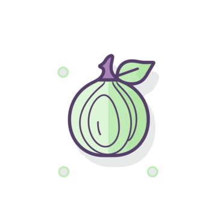
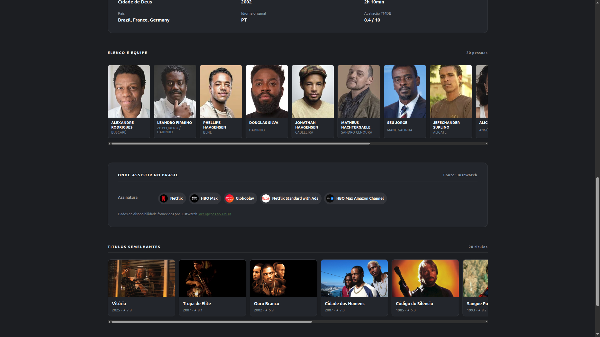

<div align="center">
  
  <h1>OpenCebola</h1>
  <p><strong>Sua interface. Sua conta Stremio. Seus addons.</strong></p>
  <p>Execute localmente, hospede onde preferir ou faça seu próprio fork.</p>
</div>

OpenCebola é uma interface independente de código aberto para facilitar o uso do ecossistema Stremio. Reúne navegação por títulos, perfis, biblioteca, progresso e integração com addons em uma base que você pode adaptar e executar na sua própria infraestrutura.

Não é necessário criar conta em um serviço dos mantenedores. A autenticação e o banco pertencem à sua instalação. A conta Stremio é conectada depois para importar os addons compatíveis que você já utiliza.

**Estado: prévia de desenvolvimento.** Esta é uma base de código, não uma oferta de assinatura ou hospedagem. Não há instaladores oficiais publicados nesta prévia. Veja o [estado de cada plataforma](docs/PLATAFORMAS.md) antes de compilar.

## Conheça a interface



Captura ilustrativa da interface de origem, selecionada sem identificação de conta. Títulos, imagens e disponibilidade são fornecidos por terceiros; não acompanham o projeto como biblioteca de vídeos. A reprodução depende das fontes autorizadas e dos serviços configurados por você. A aparência dos catálogos editoriais também depende da configuração opcional de metadados.

## Começar no seu computador

Pré-requisitos: **Node.js 22.13+**, npm e Docker em execução. O comando de banco utiliza a CLI oficial do Supabase para executar autenticação e PostgreSQL localmente; não exige conta Supabase hospedada. O primeiro início baixa dependências e imagens, portanto requer internet.

Baixe pelo GitHub ou clone o repositório:

```sh
git clone https://github.com/LucasDpaulo/OpenCebola.git
cd OpenCebola
npm run setup
npm ci
npm run db:start
npm run user:add
npm run dev
```

Abra **http://localhost:3000**. Entre com o usuário que você acabou de criar na sua instalação, crie um perfil e abra **Configurar Stremio** para conectar sua conta. Suas senhas e tokens não devem ser enviados por issue, chat ou pull request.

`setup` gera chaves próprias no `.env` ignorado pelo Git e nunca sobrescreve um ambiente existente. `db:start` inicia apenas a pilha local desta pasta e aplica as migrations; não executa reset do banco.

Prefere usar seu próprio banco/servidor? Siga [Executar e hospedar](docs/EXECUTAR.md). A hospedagem externa é opcional.

## Comandos úteis

| Comando | Finalidade |
| --- | --- |
| `npm run setup` | Criar configuração privada e chaves novas |
| `npm run doctor` | Verificar Node, npm, Docker e configuração, sem mostrar segredos |
| `npm run db:start` / `npm run db:stop` | Iniciar/parar o banco local preservando os volumes |
| `npm run user:add` | Criar acesso à sua própria instalação, com senha oculta |
| `npm run dev` | Iniciar API e interface local |
| `npm run build` | Compilar API e exportação estática web |
| `npm run native:configure` | Preparar endereços da sua instância para TVs |
| `npm run package:android` | Compilar APK de desenvolvimento, com SDK Android instalado |
| `npm run package:roku` | Gerar casca e biblioteca de telas Roku para sideload |
| `npm run package:tizen` | Gerar WGT com seu SDK e perfil de assinatura Samsung |
| `npm run package:linux` | Compilar app Linux e serviço de streaming com toolchain nativa |
| `npm run package:windows` | Empacotar no Windows após preparar as bibliotecas nativas |
| `npm run package:ios` | Preparar projeto iOS no macOS para compilar/assinar no Xcode |
| `npm run check:public` | Detectar padrões de segredos e arquivos privados antes de compartilhar |
| `npm run test:tooling` | Testar configuração e proteções dos comandos |

## Como a integração funciona

**Sua instância → sua conta Stremio → seus addons → catálogo e fontes → player compatível.**

Os addons informam quais recursos oferecem: catálogos, metadados, fontes ou legendas. O OpenCebola consulta os recursos compatíveis com o título/episódio. Fontes HTTP e torrents exigem caminhos de reprodução diferentes; conectar uma conta não garante suporte a todos os addons, codecs ou aparelhos.

O Real-Debrid pode ser usado como serviço **opcional**, com a sua conta, para resolver fontes compatíveis. **O projeto, os addons e as assinaturas de serviços não concedem direitos sobre os conteúdos.** Use apenas materiais que você tem autorização para acessar. Não há conta compartilhada, token de demonstração ou pacote de addons pré-configurado neste repositório.

Veja [Conta Stremio, addons e reprodução](docs/STREMIO.md).

## Documentação

- [Execução local e hospedagem opcional](docs/EXECUTAR.md)
- [Stremio, addons, seleção de títulos e fontes](docs/STREMIO.md)
- [Android, desktop, iOS, Tizen e Roku](docs/PLATAFORMAS.md)
- [Arquitetura e organização do código](docs/ARQUITETURA.md)
- [Resultados dos testes e pendências reais](docs/VALIDACAO.md)
- [Verificações antes de publicar seu fork](docs/PUBLICACAO.md)
- [Contribuição](CONTRIBUTING.md), [segurança](SECURITY.md) e [componentes de terceiros](THIRD_PARTY_NOTICES.md)

## Licença e independência

O código próprio desta distribuição é disponibilizado sob **GPL-3.0-or-later**; componentes de terceiros mantêm suas respectivas licenças. Consulte [LICENSE](LICENSE) e os [avisos de terceiros](THIRD_PARTY_NOTICES.md), inclusive antes de distribuir binários.

OpenCebola é um projeto independente, sem vínculo oficial com Stremio, Real-Debrid ou fabricantes dos aparelhos. Marcas e imagens de terceiros não são relicenciadas pela licença do código.
